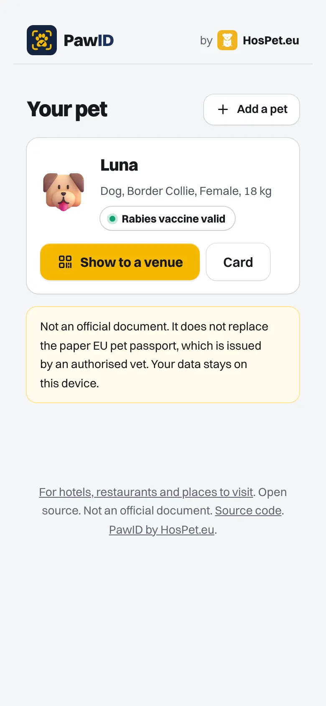
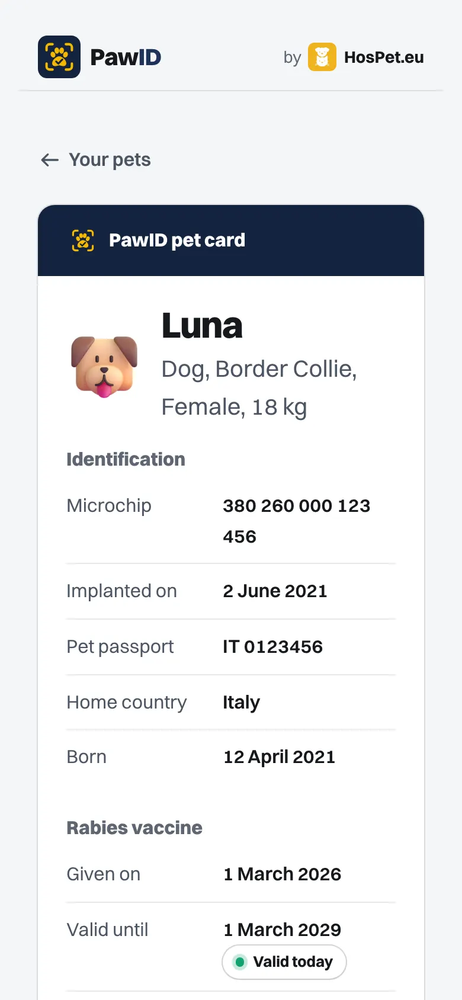
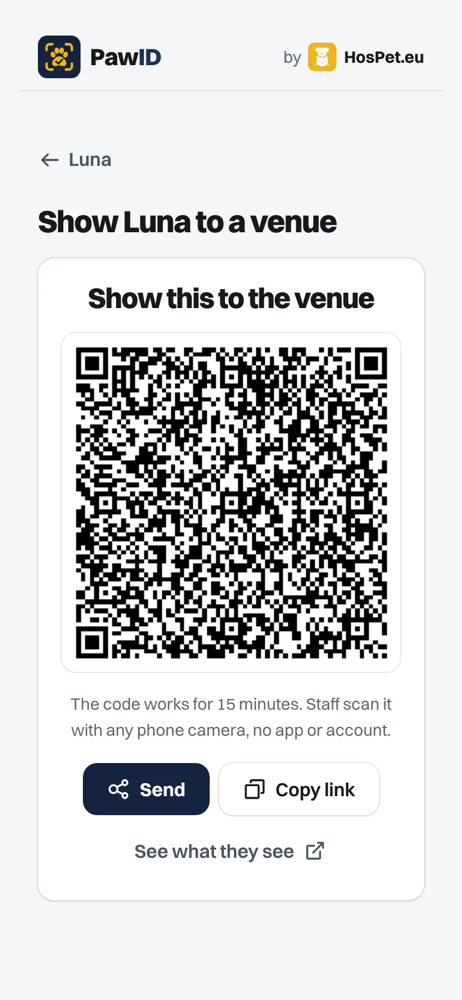
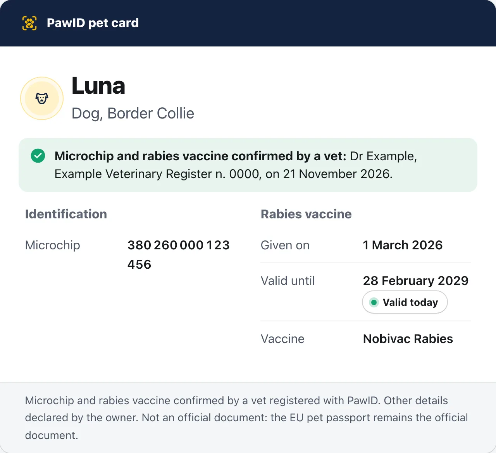

<p align="center">
  
</p>

<h1 align="center">PawID</h1>

<p align="center">
  <b>Your pet's EU passport details on your phone, ready to show at the door.</b>
</p>

<p align="center">
  <a href="https://pawid.hospet.eu"></a>
  <a href="https://pawid.hospet.eu/venues"></a>
  <br>
  <a href="https://pawid.hospet.eu/vet"></a>
  <a href="https://pawid.hospet.eu/ai"></a>
</p>

> **PawID is not an official document.** It does not replace the paper EU pet passport, which is
> issued by an authorised vet. Always carry the passport when you travel.

<p align="center">
  
  
  
</p>

Read the manifesto: [Free and open source, for a pet friendly Europe](https://pawid.hospet.eu/manifesto).

## The problem

People who travel in Europe with a dog or a cat carry a paper passport that hotels, restaurants and
museums can't easily read or check. The rules for entering each country are spread over dozens of
ministry websites in different languages. And if the rabies vaccine expires by one day, the 21 day
wait starts again.

## What PawID does

**For pet owners** ([open the app](https://pawid.hospet.eu))
- Copy the passport once: microchip, rabies vaccine (with the brand from the sticker), vet. Breed and vaccine suggestions as you type.
- Show a QR code or send a link to a hotel. You choose what it shows; it expires after 15 minutes or 7 days; it is signed, so changes show.
- Ask your vet to confirm the microchip and rabies vaccine: the venue then sees "confirmed by a vet" with the vet's name and register number.
- "Can I travel?": checks your pet against a country's rules on your travel date (21 day wait, tapeworm window with the dates, breed rules).
- Rabies expiry in your phone's calendar, with alarms 30, 7 and 1 day before. Backup by email to yourself.
- Your pets' details stay on your phone. No account, no cookies.

**For hotels, restaurants, bars, museums and places to visit** ([components and demos](https://pawid.hospet.eu/venues))
- Four free components, one line of code: a scanner for staff, your pet rules, a "Show your pet's PawID" button for booking emails, and the travel rules for your country.

**For vets** ([vet page](https://pawid.hospet.eu/vet))
- Register once with your phone. The owner gives you a 6 digit code, both phones show the same number to check, and you confirm with your fingerprint. No app, no software, free.

**For everyone**
- Pet travel rules as open data: the EU base rules plus Italy, France, Spain, Germany and Ireland, each rule with its official source and the date it was checked. Unclear points are marked "being checked", never guessed.
- Fact checks in the open: on [pawid.hospet.eu/rules](https://pawid.hospet.eu/rules) anyone can confirm a rule or suggest a correction with a source. HosPet.eu reviews each check; accepted corrections are made in the rule files here.
- Run your own copy: a city, a registry or a vet association can run PawID with its own key and vets, and copies recognise each other's vet confirmations ([how](docs/self-host.md)).
- Vet confirmations download as W3C Verifiable Credentials, the format of the European Digital Identity Wallet; codes can be stopped before they expire.

<p align="center">
  <br>
  <sub>What a hotel sees after scanning the code (example data).</sub>
</p>

## What we need

PawID is young. These are the places where help makes the biggest difference.

<p align="center">
  <a href="https://pawid.hospet.eu/vet"></a>
  <a href="https://github.com/ovixis/pawid/issues/new?template=country.yml"></a>
  <br>
  <a href="https://github.com/ovixis/pawid/issues/new?template=translation.yml"></a>
  <a href="https://pawid.hospet.eu/venues"></a>
  <br>
  <a href="https://github.com/ovixis/pawid/issues?q=is%3Aopen+label%3A%22good+first+issue%22"></a>
  <a href="https://github.com/ovixis/pawid/issues/new/choose"></a>
  <br>
  <a href="https://pawid.hospet.eu/support"></a>
  <a href="https://github.com/ovixis/pawid/security/advisories/new"></a>
</p>

| We need | Why it matters | How |
| --- | --- | --- |
| **Vets** in Italy first, then anywhere in Europe | A vet's confirmation is what makes a venue trust the card | Register at [pawid.hospet.eu/vet](https://pawid.hospet.eu/vet); we check your register number |
| **Country rules** | Only 5 countries are covered; the UK, Switzerland, Austria and the Netherlands come next | One YAML file per country, every rule from an official page ([how](CONTRIBUTING.md)) |
| **Translations** | The app is in English only | Italian, French, German and Spanish first ([open a translation issue](https://github.com/ovixis/pawid/issues/new?template=translation.yml)) |
| **Venues that try it** | Real feedback from reception desks and restaurants | Add a component, tell us what staff think |
| **Code** | Security and features | See [good first issues](https://github.com/ovixis/pawid/issues?q=is%3Aopen+label%3A%22good+first+issue%22) and [help wanted](https://github.com/ovixis/pawid/issues?q=is%3Aopen+label%3A%22help+wanted%22) |
| **Security reviews** | The app signs codes and handles vet confirmations | Report privately, see [SECURITY.md](SECURITY.md) |
| **Your name** | Grants for open source and the EU's work on a digital pet passport ask who wants this | Add a statement of support at [pawid.hospet.eu/support](https://pawid.hospet.eu/support) |

## How it works

- **On the phone:** the pet's details are stored in the browser on the owner's phone (localStorage). Backups go to the owner's own email or files.
- **Signed codes:** a code holds only what the owner chose, signed with a key made on the phone (Ed25519). A venue's check shows if anything was changed and if the code expired. Without a vet confirmation, the card says "declared by the owner".
- **Vet confirmation:** the vet signs with a passkey on their phone (WebAuthn). The PawID API checks it and seals the confirmed values; the seal travels inside the code and breaks if a value changes. Vets are approved by HosPet.eu after checking their professional register, and can be revoked.
- **Pairing a vet and an owner:** a 6 digit code, then the same 2 digit number on both phones (computed from both phones' one-time keys, like GitHub's number matching). After the owner says yes, everything travels encrypted between the two phones; the API only passes ciphertext along.
- **Rules:** YAML files in `rules/`, checked by tests: every source must be on an official host (EU institutions or a national authority).

## For developers and AI assistants

**Use PawID in your AI assistant** (copy and paste steps for every tool: [pawid.hospet.eu/ai](https://pawid.hospet.eu/ai)):

```
claude mcp add --transport http pawid https://pawid-api.hospet.workers.dev/mcp
```

Claude, ChatGPT, Cursor, VS Code and any MCP client: add the server `https://pawid-api.hospet.workers.dev/mcp` (Streamable HTTP, no key).
Agents that read skills: [`skills/pawid/SKILL.md`](skills/pawid/SKILL.md). For language models: [`llms.txt`](https://pawid.hospet.eu/llms.txt).


Read-only, no key, about 120 requests a minute per IP. Base URL: `https://pawid-api.hospet.workers.dev`.

| | |
| --- | --- |
| `GET /v1/verify?token=` | Check a PawID code: genuine, unchanged, not expired, and whether a vet confirmation holds. |
| `GET /v1/rules?country=IT` | EU base rules plus a country's differences, each with status, official sources and last check date. |
| `GET /v1/countries` | Countries with their own rules file. |
| `GET /v1/factchecks?scope=FR` | Accepted fact checks per rule (source, quote, date) and how many wait for review. |
| `POST /v1/factchecks` | Send a fact check: rule, verdict (`confirm`, `correct`, `outdated`), https source. Reviewed before it shows. |
| `POST /v1/revoke` | Stop a code before it expires (signed by the owner's key). |
| `POST /v1/credential` | A vet confirmation as a W3C Verifiable Credential (eddsa-jcs-2022, issuer `did:web:pawid.hospet.eu`). |
| `GET /v1/keys` | Recognised confirmation issuers and their public keys. |
| `GET /v1/keys` | PawID's public keys for vet confirmation seals. |
| `GET /v1/vets/:id` | Public record of an approved vet (name, register, number, country). |
| `GET /v1/openapi.json` | OpenAPI 3.1 spec. |
| `POST /mcp` | MCP server (Streamable HTTP). Tools: `verify_pet_card`, `get_pet_travel_rules`, `list_rule_countries`. |

For AI agents: [`skills/pawid/SKILL.md`](skills/pawid/SKILL.md).

Venue components, one script tag:

```html
<script type="module" src="https://pawid.hospet.eu/embed/v1.js"></script>
<pawid-scanner></pawid-scanner>            <!-- staff check a guest's PawID with the camera -->
<pawid-policy with-button>…</pawid-policy> <!-- the venue's own pet rules -->
<pawid-button venue="Hotel X"></pawid-button>
<pawid-travel-check country="IT"></pawid-travel-check>
```

Usage is counted per day without personal data: a metric, a coarse label (country code, site host name or client app name) and a number. No IP addresses, no tokens, no pet data.

## Status

| Part | Status |
| --- | --- |
| App (pets, card, QR, Can I travel?, calendar, backup) | live |
| Vet confirmation (passkey, code pairing, number matching) | live, pilot with the first vets |
| Venue components | live |
| Rules: EU base + IT, FR, ES, DE, IE | live; 5 rules still being checked |
| API and MCP server | live |
| Translations | not started |
| Owner's signing key as a non-extractable key | planned |
| Microchip registry check | not started |

## Structure

```
packages/core     shared logic: schema, expiry, signed codes, vet seals, passkey check, pairing
packages/ui       design tokens, components and the pet card
packages/rules    rules/*.yaml as typed data, with a check that every source is official
packages/widgets  Web Components for venues, built to /embed/v1.js
rules/            country requirements as YAML, each with source URL and last check date
apps/api          Cloudflare Worker (Hono) + D1
apps/web          the app (PWA), the venues page, the install guide and the vet page
```

## Principles

1. The vet is the issuer of health data. PawID never creates it by itself.
2. Data stays on the device by default. The server stores only what it must: vets' public records, anonymous counters.
3. Every rule has an official source and a date. Unverified rules are marked `needs_review`.
4. Follow the official formats (the EU passport model, the EU Digital Identity Wallet) where they exist.

## Develop

```
npm install
npm test
npm run typecheck
```

See [CONTRIBUTING.md](CONTRIBUTING.md) for country rules and code.

## License

Apache-2.0 for code. Rules data: CC BY 4.0 (see `rules/README.md`).

## Privacy

Your pets' details stay on your phone. See [PRIVACY.md](PRIVACY.md) for what the app, the API, the vet page and the venue components do with data.

## Logos

The PawID mark is a paw inside a scan frame, with a check on the pad. The files are made from
`packages/ui/src/brand.ts` with `npm run brand -w @pawid/ui`; the README cards and picture with `npx vite-node scripts/readme-assets.ts`.

Icons: [Tabler Icons](https://tabler.io/icons) (MIT), built into `packages/ui/src/icons.ts` with `npm run icons -w @pawid/ui`.
Tool logos on the AI page (Claude, ChatGPT, Cursor, VS Code, MCP): [Simple Icons](https://simpleicons.org) (CC0); the marks belong to their owners.
Pet pictures: Microsoft Fluent Emoji (MIT), see `apps/web/public/3d/CREDITS.md`.

The HosPet.eu name and logo belong to HosPet.eu. They are not covered by the Apache-2.0 licence
of this code. If you run your own copy of PawID, remove the HosPet mark and the "by HosPet.eu" line.
